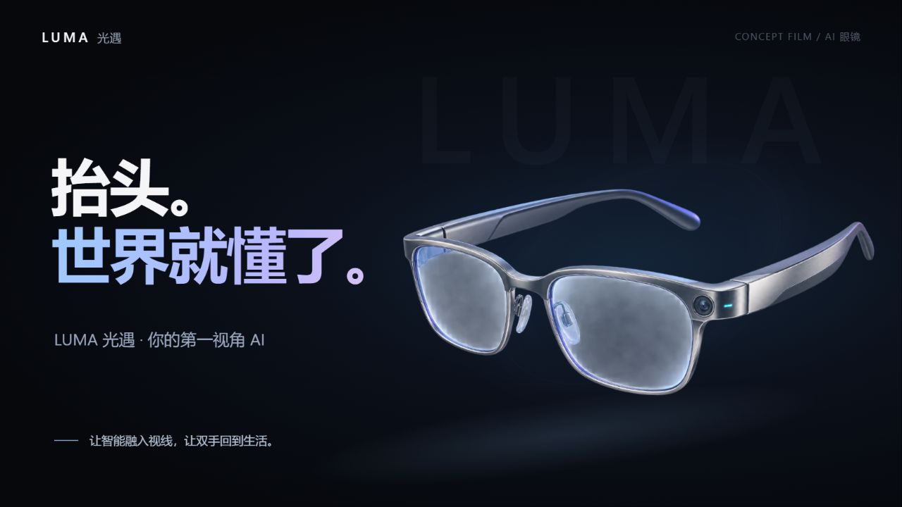

# Product Film Web

**English** | [简体中文](README.zh-CN.md)

Create a keynote-quality product promo with no editing experience: this skill builds a web studio where you can play animated scenes and record them as a video.



## What it does

Describe a product and provide any useful materials. The AI designs the story, scenes, animation, and pacing, then delivers a local HTML film studio with playback and recording controls.

- Keynote-style visuals: a dark stage, large gradient headlines, depth, and metallic display frames.
- Original storytelling for each subject, including hardware, software, services, courses, brands, or ideas.
- Autoplay, play/pause, seeking, chapter navigation, playback speed, clean mode, and fullscreen.
- Interactive scenes and real product interfaces when appropriate; optional music with synchronized playback.
- A dependency-free starter that runs locally with Node.js, without npm installation.

The default UI comes from the PaperSkill introduction film. Only its visual shell is reused; its story and scenes are not a fixed template. The skill instructions are in English, while the finished film can use the language you request.

## Use the skill

Clone the repository and place its folder in your agent's configured skills directory, or register this local repository as a skill if your agent supports it:

```sh
git clone https://github.com/happycodingday/product-film-web.git
```

The repository root contains `SKILL.md` and all supporting resources. Invoke the skill with a prompt such as:

```text
Use $product-film-web to create a roughly 60-second launch film for my AI glasses.
Use the PaperSkill UI, but invent an original story and animations for this product.
Include autoplay, pause, chapter navigation, and clean screen-recording mode.
Use Chinese captions. Here are the product details and assets: ...
```

A product description is enough to start. Images, brand assets, a website, a running software project, an audience, or a target duration can make the result more specific. Clearly request a fictional concept if you want the AI to invent the product itself.

## Try the included example

[LUMA AI glasses](examples/luma-ai-glasses/) is a complete **61-second fictional product concept** with product reveals, visual recognition, bilingual conversation, AR navigation, and memory recall. Its on-screen copy is Chinese.

From the repository root:

```sh
cd examples/luma-ai-glasses
node serve.cjs 4186
```

Open [the local demo](http://localhost:4186/). For autoplay, use `http://localhost:4186/?autoplay=1`; for a clean recording view, use `http://localhost:4186/?clean=1&autoplay=1`. Choose another port if occupied.

Pause to try the sensing options, alternate conversation, and alternate destination. Full details are in the example's [English README](examples/luma-ai-glasses/README.md) and [Chinese README](examples/luma-ai-glasses/README.zh-CN.md).

## Create a starting project manually

Requires Python 3.9+ for the initializer and Node.js for the local server. Creating a film through an agent also requires an agent that supports skills.

```sh
python scripts/init_film.py my-product-film --brand "My Product"
cd my-product-film
node serve.cjs 4178
```

Open `http://localhost:4178/`. The starter is a runnable visual shell, not a finished film. Rewrite `config.js`, scene views, and animation modules around the product; its example chapters are optional. Do not open the HTML directly from the filesystem.

## Playback and recording

| Control | Action |
| --- | --- |
| Space | Play / pause |
| R | Replay from the beginning |
| Left / right arrow | Change chapter |
| H | Hide / show player controls |
| F | Enter / exit fullscreen |
| Progress bar | Seek to any point |

Use your preferred screen recorder to capture the browser. Enable system audio if you add music. **Clean mode hides controls; it does not start recording.** The output is an HTML project, not an automatically exported MP4.

## Repository layout

```text
product-film-web/
├── SKILL.md                   # English skill instructions
├── agents/openai.yaml         # English skill UI metadata
├── scripts/init_film.py        # Dependency-free project initializer
├── references/                # Motion, UI, demo, and recording guidance
├── assets/film-starter/        # English starter UI and player
├── examples/luma-ai-glasses/   # Complete concept film with local assets
├── docs/images/               # README preview image
├── README.md
├── README.zh-CN.md
└── LICENSE
```

## Assets and license

Code is licensed under [MIT](LICENSE). The included demo uses AI-generated product and street imagery; generation prompts are documented in [ASSET-PROMPTS.md](examples/luma-ai-glasses/ASSET-PROMPTS.md). Its brand, functions, and AR views are fictional illustrations, not evidence of a shipping product or tested hardware performance. No third-party soundtrack is included. Supply appropriately licensed assets and music for your own films.
