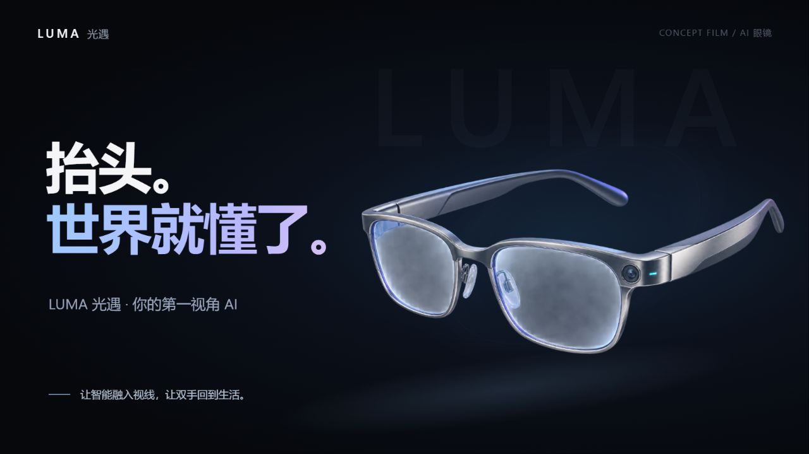

# Product Film Web · 产品映像网页

[English](README.md) | **简体中文**

**超简单的产品宣传网页 skill。** 无需剪辑经验，也能制作发布会级产品宣传片：描述你的产品，AI 为你搭建网页制作工作台，展示动画场景，再通过录屏完成宣传视频。



## 它能做什么

提供产品介绍与已有素材，AI 会自主设计故事、分镜、动画和节奏，交付可本地运行、可播放、可交互、方便录屏的 HTML 项目。

- 发布会风格：黑色舞台、渐变大字、立体层次与金属展示框。
- 针对不同对象创作内容，适用于硬件、软件、服务、课程、品牌及想法。
- 支持自动播放、暂停、进度定位、章节跳转、倍速、纯净模式和全屏。
- 按需加入可点击的演示、真实软件界面，以及与播放同步的配乐。
- 提供无依赖模板，使用 Node.js 本地运行，无需 npm 安装。

默认 UI 沿用 PaperSkill 介绍片，**只复用视觉外观，不固定故事与动画内容**。技能说明使用英文，最终影片可以按要求使用中文或其他语言。

## 使用技能

克隆仓库，将文件夹放入你的 Agent 配置的技能目录，或使用 Agent 支持的方式将这个本地仓库添加为技能：

```sh
git clone https://github.com/happycodingday/product-film-web.git
```

仓库根目录包含 `SKILL.md` 和完整配套资源。调用示例：

```text
使用 $product-film-web，为我的 AI 眼镜制作一支约 60 秒的产品发布宣传片。
沿用 PaperSkill 的 UI，根据这个产品自主设计故事、场景和动画。
支持自动播放、暂停、章节跳转与纯净录屏模式，演出文案使用中文。
产品资料和素材如下：……
```

一句产品描述即可开始；补充图片、品牌素材、官网、可运行的软件、受众和目标时长，可以让影片更贴合需求。希望 AI 连产品本身也一起设计时，请说明是虚构概念产品。

## 运行内置示例

[LUMA 光遇 AI 眼镜](examples/luma-ai-glasses/) 是一支完整的 **61 秒虚构产品概念片**，包含外观亮相、视觉识别、双语对话、AR 导航和记忆回溯，演出文案为中文。

在仓库根目录执行：

```sh
cd examples/luma-ai-glasses
node serve.cjs 4186
```

打开[本地演示](http://localhost:4186/)。自动播放地址为 `http://localhost:4186/?autoplay=1`，纯净录屏地址为 `http://localhost:4186/?clean=1&autoplay=1`。端口占用时换一个端口即可。

暂停后可以切换感知选项、对话与导航目的地。详见示例的[中文说明](examples/luma-ai-glasses/README.zh-CN.md)或[英文说明](examples/luma-ai-glasses/README.md)。

## 手动创建起始项目

初始化脚本需要 Python 3.9+，本地服务需要 Node.js；通过 Agent 生成影片还需要支持技能的 Agent。

```sh
python scripts/init_film.py my-product-film --brand "我的产品"
cd my-product-film
node serve.cjs 4178
```

打开 `http://localhost:4178/`。模板是可运行的视觉壳层，需要根据产品重写 `config.js`、分镜视图和动画模块，示例章节可以自由增删。不要直接双击 HTML 文件运行。

## 播放与录屏

| 操作 | 功能 |
| --- | --- |
| Space | 播放 / 暂停 |
| R | 从头重播 |
| 左 / 右方向键 | 切换章节 |
| H | 隐藏 / 显示控制栏 |
| F | 进入 / 退出全屏 |
| 进度条 | 定位到任意时间 |

使用自己的录屏工具录制浏览器画面；加入配乐时选择系统声音。**纯净模式只隐藏控件，不会自动开始录屏。** 交付内容是 HTML 项目，不是自动导出的 MP4。

## 仓库结构

```text
product-film-web/
├── SKILL.md                   # 英文技能说明
├── agents/openai.yaml         # 英文技能展示信息
├── scripts/init_film.py        # 无依赖项目初始化脚本
├── references/                # 动画、UI、演示与录屏指南
├── assets/film-starter/        # 英文默认模板与播放器
├── examples/luma-ai-glasses/   # 完整概念片及本地素材
├── docs/images/               # README 预览图
├── README.md                  # 英文说明
├── README.zh-CN.md             # 中文说明
└── LICENSE
```

## 素材与许可

代码使用 [MIT 许可证](LICENSE)。示例的产品图和街景由 AI 生成，提示词见 [ASSET-PROMPTS.md](examples/luma-ai-glasses/ASSET-PROMPTS.md)。品牌、功能和 AR 画面均为虚构概念，不代表真实量产产品或已验证的硬件性能。仓库不附带第三方配乐；制作自己的影片时，请使用有相应授权的图片、视频和音乐。
